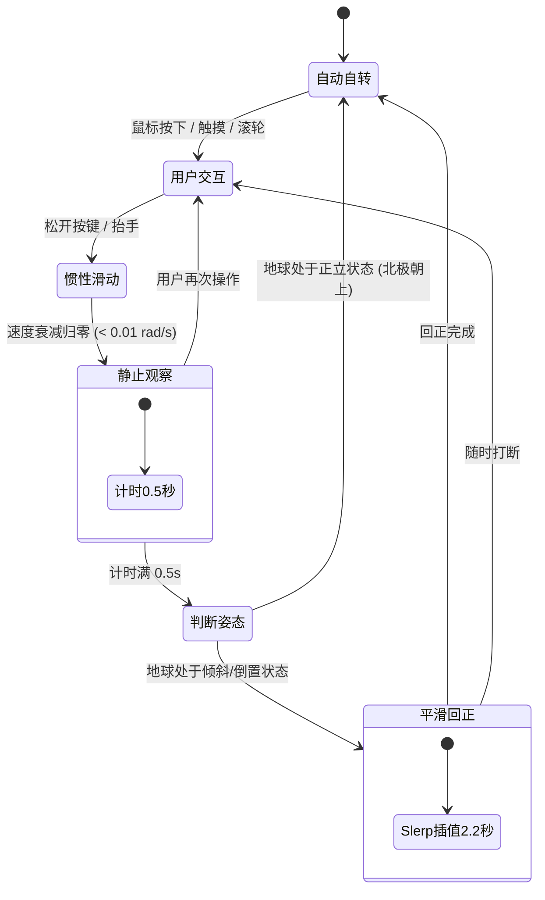

# 3D 地球交互与视觉设计规范

## 1. 节点与路线交互规范

### 1.1 路线断点悬停提示（Tooltip / Popover）
- **触发方式**：鼠标悬停（Hover）在航线关键断点或端点上触发信息提示。
- **自适应视口避让机制**：
  - 弹出前动态计算提示组件的尺寸（BoundingRect）与当前视口边缘的相对距离；
  - 若上方/右侧空间不足以完整展示，自动重新计算最佳锚定方向（如下方/左侧翻转或偏移），确保提示框始终 100% 完整显示在视口内，杜绝被外层容器或屏幕边缘裁剪。

---

## 2. 视角控制器（EarthControls）手势与旋转规范

### 2.1 平台分层交互设计

| 平台 | 操作输入 | 交互行为 | 目标与体验 |
| :--- | :--- | :--- | :--- |
| **桌面端 (Desktop)** | **鼠标左键拖拽** | **主轴受限旋转 (Yaw + Constrained Pitch)** | **高频日常操作**：沿地球自转主轴旋转经度，支持轻微俯仰，**绝对锁定 Roll 侧倾为 0**（北极始终竖直朝上，绝不侧偏倒立）。 |
| | **鼠标右键拖拽** | **全向轨迹球 (Omnidirectional Trackball)** | **深度自由探索**：支持 360° 任意姿态无死角翻滚倾斜，画布拦截屏蔽原生右键菜单。 |
| | **滚轮滑动** | **平滑距离缩放 (Smooth Zoom)** | 限制最近距离与最远距离，带惯性阻尼过渡。 |
| **移动端 (Mobile)** | **单指拖拽** | **全向轨迹球 (Trackball)** | 保持直觉的搓球体验，支持全姿态自由检查。 |
| | **双指捏合** | **双指缩放 (Pinch Zoom)** | 线性缩放平滑阻尼。 |

---

### 2.2 静止缓冲、姿态回正与自转状态机

#### 关键参数与行为准则：
1. **静止观察窗口（`realignDelay = 0.5s`）**：
   - 交互结束且惯性阻尼衰减完毕（角速度 $< 0.01\text{ rad/s}$）后，地球保持静止停留 0.5 秒，给用户留出看清目标区域的视觉停顿。
2. **北极平滑回正（`realignDuration = 2.2s`）**：
   - 不管是**鼠标左键**俯仰拖拽、**鼠标右键**全向轨迹球拖拽还是**移动端单指**操作：
     - 若地球姿态发生倾斜（`worldNorth.y < 0.999`）或相机视线偏离赤道水平面（`|camDir.y| >= 0.005`），在 0.5 秒静止等待后同时启动姿态四元数与相机轨道回正；
   - **保持经度不变**：回正时严格保持当前屏幕正对的地球表面经度，仅纠正相机俯仰与球体侧翻，视口中心聚焦区域不发生剧烈水平跳变；
   - 动画采用三次平滑缓动（Cubic Ease-In-Out）平稳落定至赤道水平且北极竖直朝上（`Y = +1`）的正立视角。
3. **无缝衔接自转**：
   - 回正完成后（或操作停止后本就处于正立状态），无缝恢复沿世界坐标垂直 Y 轴的平稳自转。
4. **手势零延迟打断**：
   - 在任何等待与回正动画期间，一旦收到新的指针按下、滑动或滚轮缩放事件，立即瞬时中断动画，将 100% 控制权交还给用户。

## 3. 2D 与 3D 投影无缝切换与收纳规范

### 3.1 两阶段错峰动力学（Two-Phase Staggered Morph）
- **3D -> 2D 展开**：
  - **阶段 1（0% ~ 45% 时间）**：球体保持 100% 封闭，球体姿态回正并将屏幕中心经度精确对齐视野，杜绝背面接缝外露；
  - **阶段 2（45% ~ 100% 时间）**：相机与姿态静止，网格如画卷展开，接缝从背面平滑滑向左右两侧。
- **2D -> 3D 收纳**：
  - **阶段 1（0% ~ 55% 时间）**：网格优先收拢回完整球体（`morph: 1 -> 0`），同时平滑收拢 2D 平移偏置（Pan Offset）；
  - **阶段 2（55% ~ 100% 时间）**：在球体已完全密封状态下，平滑插值旋转回离开 3D 前的目标姿态与相机视角。

### 3.2 2D -> 3D 收纳落定消除跳帧机制
- **四元数与纹理经度偏移完全对偶补偿**：
  - 3D -> 2D 展开时记录了纹理经度偏移量 `localAngle` 对应的四元数修正 `orbitQOffset`；
  - 2D -> 3D 收纳阶段 2 时，旋转目标严格设为 `orbitQuat * orbitQOffset`，与展开过程形成严格时间反演；
- **原子化落定更新（Atomic Settle）**：
  - 在 `finishMorph` 中，先更新 `centerLongitude`、网格姿态及 `applyView()` 航线拓扑，再显示 `overlayGroup`；
  - 瞬间关闭 `OrbitControls` 阻尼进行强行同步（`enableDamping = false -> update() -> enableDamping = true`），根除轨道控制器残余阻尼漂移导致的最后两帧抽搐跳变。