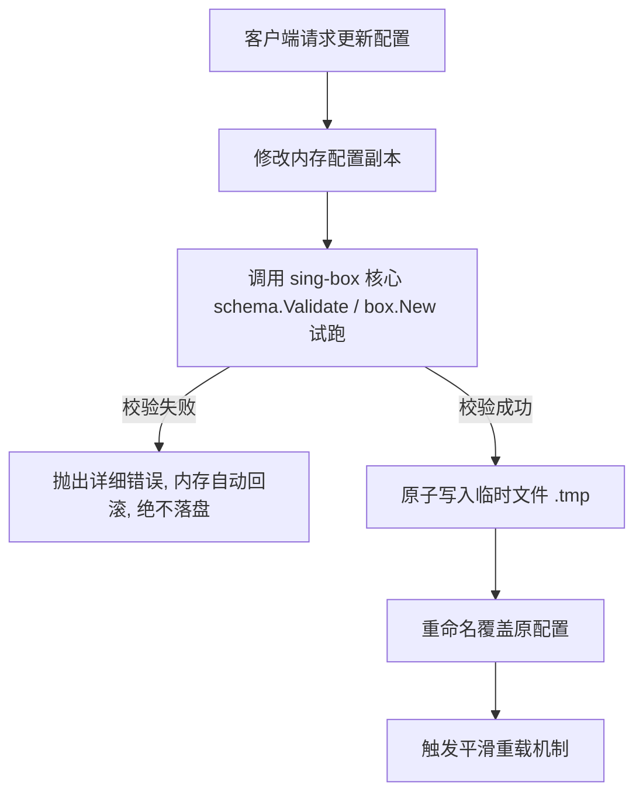

# 系统设计理念与架构原则

`sing-controller` 专为现代化、高可用的 `sing-box` 代理节点与网关管理而设计。

---

## 核心设计准则

### 1. sing-box gRPC API 为第一公民
> [!IMPORTANT]
> 本项目以 **sing-box gRPC API** 为第一公民。优先保证 sing-box 官方 gRPC 接口调用的完整性、可用性与类型安全；Clash External Controller API 仅作为兼容老客户端/生态工具的可选项。

- **原生接口**：流量采集、连接追踪、规则匹配均优先走 sing-box 原生提供的服务（如 `services[type=api]` 或 gRPC 端点）。
- **向前兼容**：对外部经典前端组件，提供透明转发与转译层。

---

### 2. 严格的原子保存与校验管线
任何由于错误配置导致的代理崩溃对于网络设备都是致命的。因此，`sing-controller` 采用了 **内存修改 → sing-box (box.New) 全量干跑校验 → 原子落盘** 的安全闭环：

- **零污染**：语法错误、端口重复、类型不合规的配置在内存阶段就会被拦截。
- **原子覆盖**：写盘时采用 POSIX 原子重命名（Windows 下使用临时替换策略），杜绝断电或并发写造成的配置半截损坏。

---

### 3. 宿主解耦与自愈能力
- Controller 与 sing-box 可以作为独立系统进程分别运行（例如通过 systemd），也可以在桌面环境下由 Controller Supervisor 自动拉起与自愈。
- 内核如果意外遭遇 OOM 异常退出，Supervisor 负责指数退避重启，保障网络高可用。
