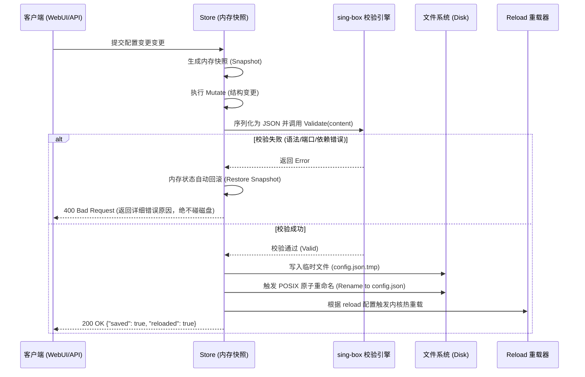

# 原子保存与校验管线

在网络代理服务中，错误的 JSON 配置可能导致主网络瘫痪，甚至导致远程 SSH 连接断开失联。
`sing-controller` 内部通过 `store.Store` 提供了强保障的防损校验管线。

---

## 校验管线步骤

在任何写操作（如 `PUT /api/config`、`PUT /api/config/raw`、`POST /api/profiles/:id/apply`）触发时：

---

## 关键安全机制

1. **真实内核干跑**：不仅仅校验 JSON 语法，而是直接调用官方 `box.New` 校验逻辑，验证 outbound tag 引用完整性、端口冲突、路由规则语法等深度语义。
2. **原子覆盖**：避免进程写盘中断写出一半残缺的文件，通过 `.tmp` 临时文件 + 原子重命名保证要么完整覆盖，要么原封不动。
3. **备份文件保留**：保存时自动保留 `.bak` 历史快照，便于灾备与回滚。
